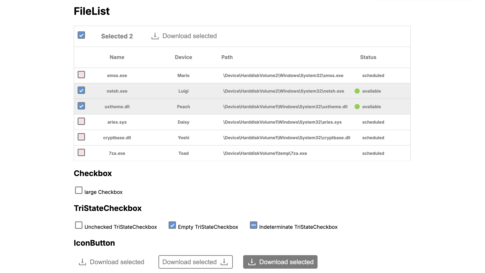
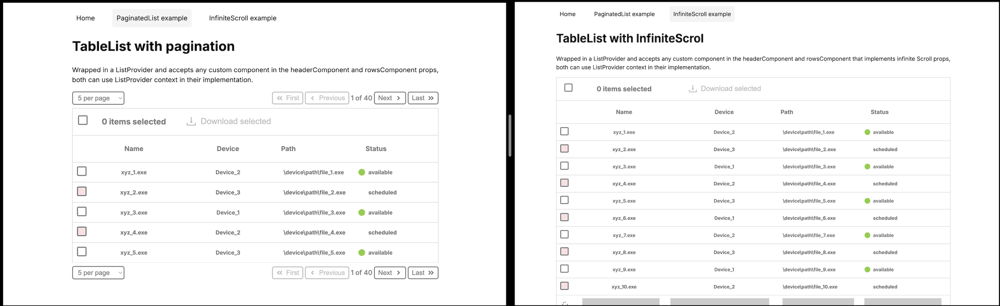

# cs-download-list

A modern React/Next.js application demonstrating advanced file list management with pagination, infinite scroll, theme support, and interactive file selection.




## Overview

cs-download-list showcases best practices in React component design, including composition patterns, context-based state management, and responsive UI. The application provides two distinct approaches to browsing large file datasets: traditional pagination and infinite scroll.

## Architecture

```
┌─────────────────────────────────────────────────────────────┐
│                        App Layer                             │
│  ┌──────────────────┐  ┌──────────────────┐                 │
│  │ Paginated List   │  │ Infinite Scroll  │                 │
│  │     Page         │  │       Page       │                 │
│  └────────┬─────────┘  └────────┬─────────┘                 │
└───────────┼──────────────────────┼──────────────────────────┘
            │                      │
┌───────────┴──────────────────────┴──────────────────────────┐
│              Context & State Management Layer                │
│  ┌─────────────────────┐      ┌──────────────────────────┐  │
│  │  ListProvider       │      │ ListProviderInfiniteScroll
│  │ (Pagination)        │      │ (Infinite Scroll)        │  │
│  └──────────┬──────────┘      └──────────┬───────────────┘  │
└─────────────┼──────────────────────────────┼────────────────┘
              │                              │
┌─────────────┴──────────────────────────────┴────────────────┐
│                      UI Component Layer                      │
│  ┌──────────────────┐  ┌──────────────────┐                 │
│  │ TableListWrapper │  │ ModalDialog      │                 │
│  │                  │  │                  │                 │
│  ├─ TableListHeader ├─ ├─ FileCard Grid   │                 │
│  ├─ TableListRows   │  │                  │                 │
│  │                  │  │ (Theme Support)  │                 │
│  └──────────────────┘  └──────────────────┘                 │
│                                                              │
│  ┌──────────────────┐  ┌──────────────────┐                 │
│  │ Pagination       │  │ CheckBox          │                 │
│  │ Component        │  │ (Tri-State)      │                 │
│  └──────────────────┘  └──────────────────┘                 │
└─────────────────────────────────────────────────────────────┘
              │
┌─────────────┴────────────────────────────────────────────────┐
│                   Data & Utilities Layer                     │
│  ┌──────────────────┐  ┌──────────────────┐                 │
│  │ files_data.ts    │  │ useTriStateCheck │                 │
│  │ (Mock Data)      │  │        Box       │                 │
│  └──────────────────┘  └──────────────────┘                 │
│                                                              │
│  ┌──────────────────────────────────────┐                   │
│  │ JSON Server (Local API - Port 5002)  │                   │
│  └──────────────────────────────────────┘                   │
└─────────────────────────────────────────────────────────────┘
```

## Quick Start

### Prerequisites
- Node.js 16+ and npm/yarn/pnpm/bun installed

### Installation & Setup

1. **Clone and Install Dependencies**
```bash
npm install
```

2. **Generate Mock Data**
```bash
npm run db:generate
```

3. **Start JSON Server** (in one terminal)
```bash
npm run server:run
```
The API server will run on `http://localhost:5002`

4. **Start Development Server** (in another terminal)
```bash
npm run dev
```

5. **Open in Browser**
Navigate to [http://localhost:3000](http://localhost:3000)

### Available Routes
- `/` - Paginated file list
- `/paginated-list` - Paginated view with navigation controls
- `/infinite-scroll` - Infinite scroll implementation

## Available Scripts

| Script | Purpose |
|--------|---------|
| `npm run dev` | Start development server |
| `npm run build` | Build for production |
| `npm start` | Start production server |
| `npm run lint` | Run ESLint |
| `npm test` | Run test suite once |
| `npm run test:watch` | Run tests in watch mode |
| `npm run db:generate` | Generate mock data for local API |
| `npm run server:run` | Start JSON server (mock API) |

## Project Structure

```
src/
├── app/                          # Next.js app directory
│   ├── layout.tsx               # Root layout with theme provider
│   ├── page.tsx                 # Default paginated list view
│   ├── paginated-list/          # Pagination example
│   │   └── page.tsx
│   └── infinite-scroll/         # Infinite scroll example
│       ├── page.tsx
│       └── actions.ts           # Server actions
├── ui/                          # Reusable UI components
│   ├── CheckBox/                # Tri-state checkbox with hook
│   ├── FileList/                # File list components
│   ├── List1/                   # Generic list implementation
│   ├── ModalDialog/             # Modal component with responsive styles
│   ├── Pagination/              # Pagination control
│   ├── TableList/               # Table-based list components
│   ├── ThemeSwitch/             # Theme toggle button
│   ├── ContentBlock/            # Flexible content wrapper
│   └── Dropdown/                # Dropdown selector
└── data/                        # Data management
    ├── files_data.ts            # Mock file data
    └── generateData.ts          # Mock data generator
```

## Key Features

### 1. Component Composition
Components accept flexible props to support multiple use cases:
- `header` prop for custom headers
- `body` prop for custom body content
- `children` for flexible slot-based design

### 2. Context-Based State Management
- **ListProvider**: Manages pagination state and filtered data
- **ListProviderInfiniteScroll**: Handles infinite scroll with intersection observer

### 3. Tri-State Checkbox
`useTriStateCheckBox` hook manages three selection states:
- All items selected
- Some items selected
- No items selected

### 4. Theme Support
Integrated with `next-themes` for seamless light/dark mode switching without flashing.

### 5. Responsive Modal Dialog
`ModalDialog` component displays selected files with:
- Responsive grid layout
- Dynamic file icons from external API
- Keyboard accessibility support

### 6. File Selection Flow
```
1. User selects files using checkboxes
2. Count and state tracked via context
3. Download button in header triggers modal
4. Modal displays selected files with icons
5. Theme automatically applied to modal content
```

## Testing

Run the test suite:
```bash
npm test
```

Run tests in watch mode:
```bash
npm run test:watch
```

Tests use **Jest** and **React Testing Library** for component testing.

## Development Patterns

### Using ListProvider for Pagination
```jsx
<ListProvider data={fileData} keyExtractor="path">
  <TableListWrapper
    headerComponent={<TableListHeader />}
    rowsComponent={<TableListRows />}
  />
</ListProvider>
```

### Using ListProviderInfiniteScroll
```jsx
<ListProviderInfiniteScroll
  data={fileData}
  keyExtractor="path"
  filter={{ status: "available" }}
>
  <TableListWrapper
    headerComponent={<TableListHeaderInfiniteScroll />}
    rowsComponent={<TableListRowsInfiniteScroll />}
  />
</ListProviderInfiniteScroll>
```

### Theme Toggle
```jsx
import { ThemeSwitch } from '@/ui/ThemeSwitch/ThemeSwitch';

<ThemeSwitch />
```

## Technologies

- **Framework**: Next.js 14 with React 18
- **Language**: TypeScript
- **Styling**: CSS Modules
- **Theme**: next-themes for dark mode support
- **Icons**: react-icons
- **Intersection Observer**: react-intersection-observer for infinite scroll
- **Testing**: Jest + React Testing Library
- **Mock API**: json-server

## Browser Support

Modern browsers (Chrome, Firefox, Safari, Edge) with ES2020+ support.

## License

MIT

## Contributing

Contributions welcome! Please ensure tests pass and code follows the linting standards.

```bash
npm run lint
npm test
```
